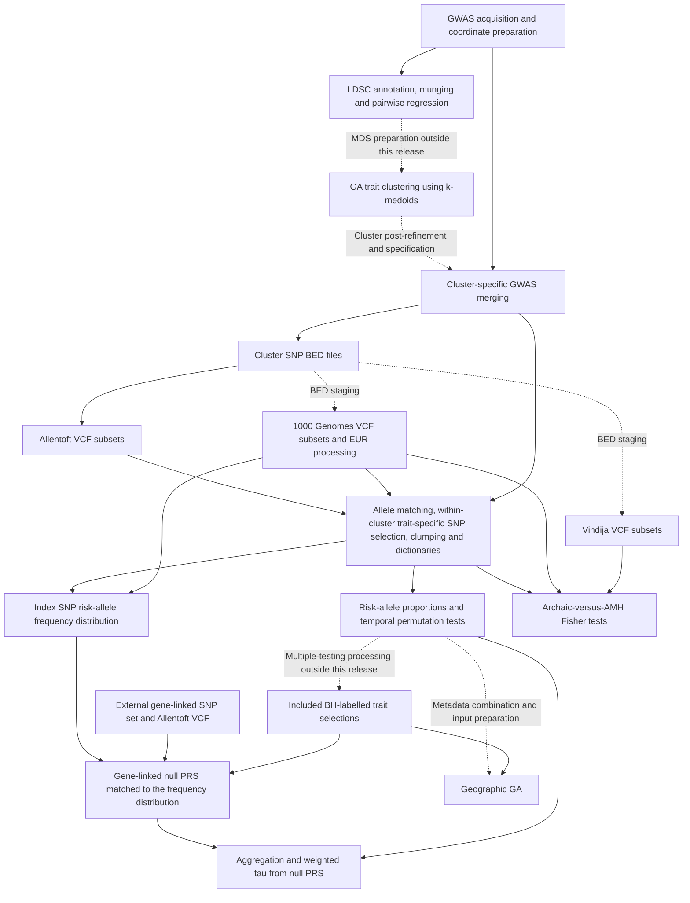

# Dietary endophenotype evolution: provisional code repository

Code supporting the manuscript:

**Beyond single-trait analysis: ancient genomes reveal coordinated evolution of dietary endophenotypes in Holocene Europe**

Carla Casanova-Suarez, Karen Hardy and Oscar Lao.

Prepared for scientific review.

Preprint (bioRxiv): [10.64898/2026.10.27.762183](https://doi.org/10.64898/2026.10.27.762183).

## Release status and scope

This independent publication repository contains selected scripts from the computational pipeline executed on the CESGA high-performance computing cluster. It documents the cluster analyses, their configured parameters, and their input/output relationships. Some intermediate files and results were subsequently processed locally in R; those local workflows are outside the present release.

**This is a preliminary, partial code release. It has not been demonstrated to execute independently or reproduce the manuscript results from the contents supplied here.** Internal analytical functions, research datasets, intermediate products and generated results are omitted. Selected job arrays and supporting annotations are included; an array listing a file does not mean that the listed file is distributed.

The descriptions below are based on the included source and author clarification. Explicit script calls and file references establish configured relationships, but do not establish that every launcher was submitted with its present array range or that all file handoffs have been validated. The manuscript remains the reference for the scientific interpretation; this README does not assign unverified figure numbers to scripts.

## Directory guide

The existing organization is retained. Most folders correspond to one analytical component; R and Python entry points are generally called by shell launchers in the same component.

```text
scripts_ldsc_regression/                 GWAS preparation and pairwise LDSC
  Example_arrays/                       GWAS and LDSC job specifications
  python_scripts/                       Genome-build conversion entry point
scripts_GA_clustering/                   Genetic-algorithm trait clustering with k-medoids
  R_scripts/clustering_kmedoids/
scripts_merge/                          Cluster-specific GWAS merging
  arrays/                               GWAS filenames, labels, builds and paths
  download_GWAS_diet/                    Original acquisition commands
  parsers_GWAS_cols/                     Coordinate-column preparation
  python_scripts/
scripts_subset_aDNA/subset_Allentoft/    Allentoft VCF subsetting and processing
  python_scripts/                       BED-file creation
scripts_subset_1000G/                   1000 Genomes Phase 3 VCF processing
scripts_SNP_ascertainment/              Allele matching, PLINK clumping, dictionaries
  arrays/                               Trait lists used by job arrays
  python_scripts/
scripts_proportion_risk_alleles/Allentoft/
  python_scripts/                       Proportions and temporal statistics
scripts_null_distribution_linked_SNPs/  Frequency-matched, gene-linked null analyses
  arrays_clusters/                      Configured trait selections
  python_scripts/
scripts_GA_geo_trend/                   Geographic differences in temporal trends
  arrays_clusters/                      Configured significant-trait selections
  R_scripts/
scripts_subset_vcf_archaics/            Vindija VCF preparation
scripts_selective_pressures_archaics/   Archaic-versus-AMH lineage comparisons
  arrays_clusters/
  python_scripts/
```

`AGENTS.md` contains repository-maintenance instructions. `.codex/` contains local tooling configuration; neither is part of the scientific pipeline.

## Workflow overview

Solid arrows summarize configured analytical dependencies. Dashed arrows mark preparation, selection or staging steps that are not fully represented in this release. The diagram is a reading guide, not an automated execution graph. File handoff qualifications are listed under [Current limitations](#current-limitations).



## Analytical components and execution order

Numbering orders steps within a component. It does not define a single repository-wide submission sequence. Cluster identifiers in filenames refer to analytical trait groups, whereas CESGA refers to the computing environment.

### 1. GWAS preparation and genetic correlations

The [download commands](scripts_merge/download_GWAS_diet/) record original GWAS acquisition locations. The [coordinate parsers](scripts_merge/parsers_GWAS_cols/) prepare coordinate fields in selected summary-statistic formats. Raw summary statistics are not included, and current URL accessibility and redistribution permissions have not been verified.

The LDSC sequence is documented in [scripts_ldsc_regression](scripts_ldsc_regression/):

| Step | Included launcher or entry point | Required inputs | Declared products |
| --- | --- | --- | --- |
| Build conversion | [Build_conversion_from_hg38_to_hg19_unprocessed_GWAS_Diet.sh](scripts_ldsc_regression/Build_conversion_from_hg38_to_hg19_unprocessed_GWAS_Diet.sh) calls [Fast_build_conversion_GWAS_sumstats.py](scripts_ldsc_regression/python_scripts/Fast_build_conversion_GWAS_sumstats.py) | GWAS files, chromosome/position columns, internal methods, liftOver executable and chain files | Converted coordinates and mapping products; naming is partly delegated to internal methods |
| rsID annotation | `00.04` through `00.07` shell scripts | GWAS files, column specifications, coordinate-to-rsID table | Summary statistics with LDSC rsIDs |
| Munging | `01.*Munge_sumstats*` launchers | Annotated statistics, sample-size and allele fields, LDSC, HapMap3 allele list | `.sumstats.gz` files and munging logs |
| Pairwise analysis | [02.00.Ldsc_regression_Diet.sh](scripts_ldsc_regression/02.00.Ldsc_regression_Diet.sh) | Munged statistics and European reference LD scores | Pairwise LDSC logs and an analysis-issue log |
| Tabulation | [03.00.Table_with_pairwise_ldsc_results.sh](scripts_ldsc_regression/03.00.Table_with_pairwise_ldsc_results.sh) | LDSC result logs | `Diet_GWAS_pairwise_ldsc_regression_94_traits.tsv` |

The analysis uses hg19/GRCh37 coordinates. The author confirms that two GWAS were converted from hg38 for the LDSC analysis. The [conversion array](scripts_ldsc_regression/Example_arrays/array_meta-analyses_Diet_build_conversion_hg38_to_hg19.tsv) identifies `GCST90475156.tsv.gz` and `GCST90475153.tsv.gz`. The pairwise LDSC array contains 94 entries; this is distinct from the 58-trait input named by the clustering launchers.

[IMPORTANT_munge_sumstats_bug.txt](scripts_ldsc_regression/IMPORTANT_munge_sumstats_bug.txt) describes a manual LDSC modification for extremely small p-values. The installed, modified LDSC source is not distributed here. Its exact version and behavior therefore remain an external dependency.

### 2. Genetic-algorithm clustering of traits with k-medoids

[scripts_GA_clustering](scripts_GA_clustering/) contains K2 through K10 launchers named `02.03.Elitism.launch_GA_clustering_KMEDOIDS_traits_Diet_100iter_400pop_0_2MR_K*_4dim.sh`, calling [Run_GA_clustering_traits_Diet_by_kmedoids.R](scripts_GA_clustering/R_scripts/clustering_kmedoids/Run_GA_clustering_traits_Diet_by_kmedoids.R).

- **Input:** `LDSC_MDS_matrix_Diet_58_GWAS_interval_4dim_BMIUKB.tsv`, with a `Codes` column and MDS coordinate columns. This table and its preparation workflow are not included.
- **Visible operation:** the R entry point computes Euclidean distances from `D1` and `D2` and passes the distance matrix to `evolve.or.die.clusters.parallel.kmedoids`. The `4dim` filename does not establish that all four dimensions are used by this entry point. The function is expected from the external `Functions_GA_clustering_traits_by_kmedoids.R` file sourced under `R_scripts/clustering_kmedoids/`; that file and its implementation are not included.
- **Output:** `Best_clustering_GA_Diet_*.rda`, under the configured `GA_clustering_traits_Diet/using_kmedoids/dimensions_4/Elitism/` results directory.

The current k-medoids/interval configuration has not been executed or validated against manuscript outputs as part of repository preparation.

The four-cluster GWAS specifications supplied in the merging component reflect the post-refinement assignments confirmed by the author. In particular, `DHA_BioPsych_2023` was reassigned from cluster 4 to cluster 3 during post-refinement; the supplied merging and downstream ascertainment arrays use cluster 3. The conversion from initial clustering results to these refined specifications is not implemented by an included script.

### 3. Cluster-specific GWAS merging

The four `01.*Launch_outer_merge*` launchers in [scripts_merge](scripts_merge/) call their corresponding Python scripts in `python_scripts/`. Each uses an included specification table in `arrays/`, containing GWAS filenames, phenotype labels, genome builds and original input paths.

The merge threshold is `1e-03`. This broader threshold was used to retain more data in the initial intermediate files, allowing the downstream analysis threshold to be changed without rebuilding those files. It is not the association threshold used for the final SNP ascertainment analysis, which is `1e-05`. The custom merge call enables INDEL filtering and restricts variants to autosomal, biallelic sites. Outputs are `Merged_GWAS_meta_analyses_Diet_*_outer_pval_1e-03.tsv.gz`, with additional `_dup_filt.tsv.gz` products written only under the duplicate-handling condition in the code. Some downstream steps explicitly reference those conditional products.

The configured groups use labels based on logTG, trunk fat percentage, total cholesterol and trunk fat-free mass. The historical string `Trunk_dat_free_prot` is retained in some paths and output names; these literal names are part of the file interfaces.

### 4. Ancient and present-day VCF processing

The branches operate on autosomal chromosome files, 1 through 22:

| Component | Local sequence | Required inputs | Declared products |
| --- | --- | --- | --- |
| [Allentoft](scripts_subset_aDNA/subset_Allentoft/) | `00.*` BED creation; `01.03` VCF subsetting; `02.*` sorting/indexing; `03.*` concatenation | Merged GWAS, preprocessed Allentoft VCFs, BED specifications and chromosome list | Cluster BED files, chromosome VCF subsets, concatenated sorted VCFs and tabix indexes |
| [1000 Genomes](scripts_subset_1000G/) | `01.*` subsetting; `02.*` sorting/indexing; `03.*` concatenation; `04.*` EUR processing | Phase 3 hg19 VCFs, cluster BED files, chromosome list and `EUR.samples.txt` | Cluster VCFs and EUR subsets with recalculated tags and assigned variant IDs |
| [Vindija](scripts_subset_vcf_archaics/) | `01.*` header preparation/subsetting; `02.*` sorting/indexing; `03.*` concatenation | Vindija VCFs, cluster BED files, included contig header and chromosome list | Cluster-specific sorted/indexed Vindija VCFs |

The Allentoft source filenames identify preprocessed, diploid-imputed data and include QC labels such as `INFO_0.8`, `MAF_0.01` and `GP_0.8`. These scripts consume that previously prepared dataset; they do not implement its complete upstream QC or imputation workflow.

BED creation is included under the Allentoft component. The 1000G and Vindija launchers expect BED files in their own configured directories; copying/staging these products across components is not automated here.

### 5. Allele matching and SNP ascertainment

The sequence in [scripts_SNP_ascertainment](scripts_SNP_ascertainment/) is:

| Prefix | Operation and analytical entry point | Products consumed downstream |
| --- | --- | --- |
| `00.*` | GWAS-to-Allentoft matching: `Merging_and_fixing_alleles_GWAS_to_Allentoft.py` | Matched GWAS tables |
| `01.*` | 1000G matching: `Merging_alleles_GWAS_1000G_data_fix_VCF.py` | Updated GWAS tables with 1000G identifiers and filtered/sorted VCFs |
| `02.*` | PLINK binary-file preparation | `.bed`, `.bim` and `.fam` files |
| `03.*.02` | Within-cluster trait-specific SNP selection and association-file creation: [Create_assoc_file_merged_GWAS_by_trait_for_clumping_with_plink_and_1000G_data.py](scripts_SNP_ascertainment/python_scripts/Create_assoc_file_merged_GWAS_by_trait_for_clumping_with_plink_and_1000G_data.py) | `.assoc` files containing SNPs uniquely associated with the target trait within its cluster at `1e-05` |
| `04.*.02` | PLINK clumping | Parsed `.clumped` files |
| `05.*` | `SNP_ascertainment_from_PLINK_clumping_and_fixed_GWAS_with_Allentoft_aDNA_by_trait_from_merge.py` | `.pkl` dictionaries of index SNPs and linked candidates, plus ascertainment logs |

The unique-SNP selection occurs in `Create_assoc_file_merged_GWAS_by_trait_for_clumping_with_plink_and_1000G_data.py`, before LD clumping. It extracts the p-value columns from the cluster-specific merged GWAS dataframe and calls the internal `number_of_unique_SNPs_associated_by_trait_and_pval_threshold` function. As clarified by the author, SNPs are selected for association with the target trait at `p < 1e-05` without association at that threshold with another trait in the same cluster dataframe. These represent **trait-specific within-cluster components**; uniqueness is assessed relative to the other traits in that cluster, not across all traits in the study. The internal selection function is not included in this release.

Uniqueness is assessed at the analysis threshold, rather than inherited from the broader `1e-03` intermediate selection. Clumping and dictionary creation also use `1e-05`. References to `1e-03` in these launchers identify upstream merged GWAS/VCF products retained for threshold flexibility; the downstream association threshold remains `1e-05`. Here, index SNPs refers to the ascertained independent markers represented by the SNP-dictionary keys, distinct from the traits representing clusters in trait clustering.

Clumping uses `--clump-p1 1e-05`, `--clump-p2 1e-05`, `--clump-r2 0.2`, `--clump-kb 500` and `--geno 0.8`. Dictionary creation supplies [complex_LD_regions_hg19_chr.tsv](scripts_SNP_ascertainment/complex_LD_regions_hg19_chr.tsv) to the internal QC function. The region table includes `chr`, `start`, `end` and `annotation`; its filtering implementation is in the omitted module.

The four trait arrays are in `arrays/`. `select_traits_by_number_of_independent_positions.sh` selects entries with more than 20 independent positions from an ascertainment log; `prepare_array_with_SNP_dict_filenames_using_a_list_of_selected_traits.sh` creates dictionary/trait arrays from a supplied selection. These helpers require explicit command-line inputs.

### 6. Risk-allele proportions and temporal trends

In [scripts_proportion_risk_alleles/Allentoft](scripts_proportion_risk_alleles/Allentoft/):

- `01.*Launch_proportion_risk_alleles*` calls `calculate_proportion_risk_alleles_Allentoft_and_weighted_or_regular_tau_using_ancient_DNA_and_SNP_dict.py`.
- `02.*Launch_weighted_Tau_permutation_test*` calls `calculate_observed_weighted_or_regular_tau_and_null_distribution_proportion_risk_alleles_using_ancient_DNA_and_SNP_dict.py`.
- `prepare_df_all_traits_results_proportion_risk_alleles_clusters.sh` aggregates supplied proportion outputs.

**Inputs:** sorted/indexed Allentoft VCFs, SNP dictionaries, included trait arrays, and an external metadata table containing `Sample_ID` and `Age.average`. Metadata membership controls which samples enter the temporal analysis.

**Products:** `Proportion_risk_allele_*.tsv`, `Presence_risk_allele_indep_*.tsv`, observed-tau logs, `Null_distribution_Kendall_tau_prop_risk_*.tsv`, permutation-test logs and aggregated proportion tables.

Launchers enable weighted tau, using bin arguments start `400`, end `15000`, size `500`, and `--filt_outlier_bins_by_y 10000`. The exact weighting and outlier-bin behavior is delegated to internal methods; this argument alone should not be interpreted as a complete description of sample filtering. Permutations use 10,000 replicates and seed `3895725384`.

The supplied BH-labelled selections in subsequent components identify configured downstream traits. The multiple-testing calculation and its test family are not implemented by an included script.

### 7. Gene-linked, allele-frequency-matched null analyses

[scripts_null_distribution_linked_SNPs](scripts_null_distribution_linked_SNPs/) contains:

1. `00.*Launch_add_EUR_AF*` calls `Add_EUR_AF_from_1000G_ph3_hg19_using_SNP_dict_target_trait.py`, using SNP dictionaries and 1000G annotations to produce `SNPs_*_indpMarkers_with_EUR_AF_risk_alleles.tsv`. A separate cluster-1 negative-control annotation launcher is included; a complete downstream negative-control simulation sequence is not supplied.
2. `01.*Launch_null_PRS*` calls `Null_distribution_PRS_SNPs_linked_to_genes_matching_AF.py`. Inputs include the index-SNP risk-allele frequency table, an external gene-linked null SNP table with `chr`, `pos` and `ALT_AF`, an indexed Allentoft VCF for that set, and GWAS data for excluding associated SNPs. Outputs are per-trait `Null_PRS_*.tsv` tables.
3. `merge_null_PRS_cluster.sh` combines per-trait products into `processed_df/Null_PRS_1000replicates_allentoft_SNPs_50Kb_togenes_<cluster>.tsv`.
4. `02.*Launch_weighted_tau_distribution*` calls `From_null_PRS_to_weighted_tau_distribution.py`, using the combined null PRS, sample metadata and observed permutation-test tau logs. Outputs are weighted-tau distributions and comparison logs.

For each trait, matching targets the empirical distribution of European risk-allele frequencies across its ascertained index SNPs. The entry point supplies the full table of individual `Risk_allele_AF` values to the internal matching function, rather than a single mean frequency. The matching implementation is omitted; exact matching behavior cannot be verified from this release alone. The historical argument name `--prototype_SNPs_file` refers to this index-SNP frequency table.

The simulation launchers configure 1,000 replicates, seed `1234`, AF span `0.05`, and exclusion of target-trait-associated SNPs at `1e-05`. The null set is described by filenames and interfaces as SNPs within 50 kb of protein-coding genes. Construction of that set and its VCF is outside this release. The weighted-tau step uses the temporal bin and outlier arguments described above.

### 8. Geographic variation in temporal trends

The three launchers in [scripts_GA_geo_trend](scripts_GA_geo_trend/) call [Run_GA_geographic_trends_split_Diet_by_trait.R](scripts_GA_geo_trend/R_scripts/Run_GA_geographic_trends_split_Diet_by_trait.R).

**Inputs:** included significant-trait arrays and external per-cluster tables named `Diet_all_traits_<cluster>_classified_Allentoft_temporal_trends_400-10yearsBP_results.tsv`. The entry point requires `Trait` and the configured columns `Age.average`, `Proportion_risk_allele`, `Longitude.ok` and `Latitude.ok`.

**Output:** `Best_geographic_trend_differences_GA_*.rda`. Preparation of the combined input tables and the custom geographic GA implementation are not included. The literal `400-10yearsBP` filename is retained without inferring its meaning from the name alone.

### 9. Archaic-versus-AMH lineage comparisons

Four launchers in [scripts_selective_pressures_archaics](scripts_selective_pressures_archaics/) call [Assess_selective_pressures_associated_SNPs_homo_vs_AMH_lineages.py](scripts_selective_pressures_archaics/python_scripts/Assess_selective_pressures_associated_SNPs_homo_vs_AMH_lineages.py).

**Inputs:** included trait arrays, SNP dictionaries, merged GWAS, indexed Vindija and 1000G VCFs. The entry point combines GWAS effects, ancestral-allele/frequency annotations and archaic calls, recovers independent positions using the dictionaries, and delegates Fisher tests to an internal method.

**Products:** annotated independent-marker tables and logs containing odds ratios and two-sided, greater and less p-values. The configured GWAS association threshold is `1e-05`. The internal test implementation is omitted, so its contingency-table construction cannot be assessed fully from this entry point.

## Computational environment and interfaces

The launchers were configured for Bash, CESGA modules and SLURM. Many use Bash process substitution, UNIX text-processing utilities, `bgzip` and `tabix`. Most jobs are intended to be submitted with `sbatch`, with their original `#SBATCH -D` working directories and log paths. They are not portable local-run instructions as supplied.

| Use | Active configuration visible in launchers |
| --- | --- |
| Python/internal methods | `cesga/system miniconda3/22.11.1-1`; conda environment `vegeta_last` |
| LDSC | The same Miniconda module; conda environment `ldsc` |
| R analyses | `cesga/2022 gcc/system`; `R/4.3.3` |
| VCF/BED operations | `bedtools/2.30.0`; `bcftools/1.19`; some steps use `cesga/2020 bcftools/1.19` |
| LD clumping | `plink/1.9b5` |

Direct Python imports include pandas, NumPy and pysam, together with the internal modules listed below. R entry points load doParallel, doRNG, dplyr, tidyr and, for clustering, stringr; they also call foreach interfaces. Python and R package versions, LDSC revision, liftOver version and complete environment definitions are not pinned in this release. Dependencies of the omitted functions cannot be enumerated completely.

### Command-line arguments

Shell launchers provide the configured argument combinations and are the primary reference for a particular analysis. Python argument declarations are in each entry point's `argparse` section. Common groups are:

| Entry point/group | Main argument interface |
| --- | --- |
| Build conversion | `--file`, `--dir`, `--chr_col`, `--pos_col`, `--original_build`, `--directory_liftOver` |
| GWAS merging | `--array_file`, `--out_dir`, `--pval_threshold` |
| Allele matching | `--gwas_data_file`, `--in_dir`, `--vcf`, `--out_dir`, `--info_outfile` |
| Association files/dictionaries | `--gwas_data_file`, `--phenotype_name`, `--pval_threshold`, output/log arguments; dictionary creation additionally uses `--plink_clumped_file` and `--regions_qc` |
| Temporal statistics | VCF/index, `--SNP_dict`, metadata, y-variable, bin/filter and output/log arguments; permutations additionally require `--number_replicates`, `--cpus` and `--seed` |
| Null PRS | `--null_set_file`, `--prototype_SNPs_file`, VCF/index, replicate/CPU/seed/AF-span arguments, and configured GWAS-exclusion options |
| Null weighted tau | `--null_PRS_cluster_results`, `--tau_log_observed`, metadata, bin/filter, CPU and output/log arguments |
| Archaic comparisons | `--SNP_dict`, archaic/1000G VCFs and indexes, GWAS, trait label, threshold and output/log arguments |

The R runners use positional arguments in this order:

```text
Trait clustering:
population_size mutation_rate iterations reproduction_type K
MDS_file output_directory number_of_cores [tournament_size]

Geographic analysis:
population_size mutation_rate iterations reproduction_type
sample_table x_variable y_variable longitude_column latitude_column
output_directory trait number_of_cores [tournament_size]
```

Both R runners require an output directory ending in `/`; several Python interfaces also require trailing directory separators. Preserve the exact launcher arguments when interpreting file paths and outputs.

### GA settings and resource requests

Trait-clustering launchers configure k-medoids, population 400, mutation rate 0.2, 100 iterations, elitist reproduction, K2-K10 and 16 workers. Geographic launchers configure population 200, mutation rate 0.2, 100 iterations, tournament reproduction, tournament size 5 and 16 workers. The visible R runners do not set an explicit random seed; random-state handling inside omitted functions is not established here.

SLURM requests range from `--mem=10000` to `--mem=150000`, with walltimes from one to nine hours. Parallel launchers commonly request 20 CPUs and pass 16 or 17 workers to the analysis. These are configured allocations, not measured minimum requirements or execution benchmarks. Input data and memory use vary by stage and trait.

## Included specifications and omitted material

Included specifications comprise GWAS merging/LDSC arrays, SNP-ascertainment trait lists, temporal-analysis arrays, downstream significant-trait arrays, the Allentoft cluster-to-BED array, complex-LD-region annotations, and the Vindija chromosome/contig support files.

### Trait ID annotation alignment

Journal/year annotations in the supplied arrays were checked against the `Trait ID` column of the author-provided `Diet_manuscript_supplementary_tables_1_2_3.xlsx`, sheet `Sup Table 1 - GWAS`. That workbook is not distributed in this repository. The following annotation corrections were applied consistently to GWAS merge phenotype labels, ascertainment trait lists, LDSC derived-file references, and downstream dictionary/trait references wherever they occurred:

| Earlier label | Corrected Trait ID | Supplementary Table 1 cell |
| --- | --- | --- |
| `F-Acquired_food_liking_NatGen_2022` | `F-Acquired_food_liking_NatCom_2022` | B39 |
| `F-savory_food_liking_NatGen_2022` | `F-savory_food_liking_NatCom_2022` | B40 |
| `F-highly_Palatable_food_liking_NatGen_2022` | `F-highly_Palatable_food_liking_NatCom_2022` | B41 |
| `F-vegetarian_food_liking_NatGen_2022` | `F-vegetarian_food_liking_NatCom_2022` | B42 |
| `eBMD_NatGen_2027` | `eBMD_NatGen_2017` | B36 |
| `Prop_carb_NatHumBeha_2023` | `Prop_carb_NatHumBeha_2022` | B18 |
| `Prop_fat_NatHumBeha_2023` | `Prop_fat_NatHumBeha_2022` | B19 |
| `Prop_protein_NatHumBeha_2023` | `Prop_protein_NatHumBeha_2022` | B20 |

These edits preserve array row order, trait-name structure, marker counts, raw source filenames, thresholds and analytical code. A shortened identifier that omits the year is not treated as an error solely for that omission. Historical external artifacts may still use earlier labels in `.pkl`/derived filenames, merged-GWAS column suffixes or result metadata. They require a coordinated identifier migration before use with the corrected arrays; changing a filename alone does not update labels stored within a file. No external datasets, dictionaries or results were renamed or modified during this correction, and execution with those artifacts has not been verified.

The following components are not supplied:

- Internal Python modules `merge_GWAS_phenos`, `work_vegeta` and `ancient_vegeta`, imported from the configured `vegeta_last_version` installation.
- `Functions_GA_clustering_traits_by_kmedoids.R`, including the called `evolve.or.die.clusters.parallel.kmedoids` implementation.
- `Functions_GA_geographic_trend.R`, including `evolve_or_die_geo_trends_across_time` and the geographic optimization details.
- GWAS summary statistics; ancient, present-day and archaic VCFs/indexes; sample metadata and sample lists; gene-linked null SNP/frequency datasets.
- Intermediate merged statistics, BED/PLINK files, clumping results, SNP dictionaries, MDS/combined metadata tables, simulation products, analysis logs and final results.
- Local R workflows for processing intermediate files/results; the MDS preparation, final cluster selection/export, multiple-testing processing and geographic input preparation are not reconstructed in this release.
- LDSC software and its installed modification, reference LD scores, HapMap3 allele list, liftOver executable/chains and complete software environments.

These omissions must not be interpreted as instructions to recreate internal methods or substitute data. Sharing status must be assessed separately for each item.

## Current limitations

1. **External arrays:** six UKB lists referenced by LDSC are absent: `array_UKB_Anthropometric.txt`, `array_UKB_Metabolic.txt`, `array_UKB_Psychiatric.txt`, and their corresponding `_with_rsID.txt` lists. Four coordinate-parser lists are also absent: `array_parse_UKB_Ant.txt`, `array_parse_UKB_Met.txt`, `array_parse_UKB_Psyc.txt` and `array_parser_diet_composition.tsv`. Launchers point to their original CESGA data locations.
2. **Other missing support files:** `ldsc_rsID_with_coords_list.tsv` is referenced by LDSC annotation scripts but not distributed. `chromosomes.txt` is included under `scripts_subset_vcf_archaics/`, but is absent at the separate paths expected by the Allentoft and 1000G sorting launchers. `EUR.samples.txt` and the temporal sample-metadata table are also external.
3. **Original path assumptions:** absolute CESGA code, input, scratch, output and log locations remain in the scripts, along with `$HOME`, `$LUSTRE` and working-directory assumptions. Folder placement in this repository does not recreate those locations.
4. **Unverified file handoffs:** Allentoft concatenation produces a `.sorted.vcf.gz` under `sorted/`, while initial GWAS-to-Allentoft matching references a differently located VCF without that suffix. The original staging relationship has not been established. Conditional `_dup_filt` outputs and BED staging also require the corresponding original products and provenance.
5. **Job selection and orchestration:** some launchers retain partial or nonconsecutive SLURM array selections. They should not be interpreted as complete records of every original submission. There is no master dependency-aware submission script. Array row order controls trait/job selection; it is part of the interface.
6. **Incomplete methodological visibility:** core calculations depend on omitted functions. The visible entry points and parameters do not establish the complete algorithms, multiple-testing family, allele-handling behavior or geographic GA implementation.
7. **Validation status:** repository preparation has used static inspection and file/reference checks. No cluster analysis or comparison against manuscript outputs has been performed as part of preparing this release. Passing documentation checks would not demonstrate scientific reproduction.

## Editorial review and additional material

Requests for consideration of additional material should identify the relevant analytical component and files through the manuscript's editorial correspondence. This repository does not establish authorization to release the omitted internal modules, R functions, datasets, metadata or result files. Any provision would require confirmation by the authors of ownership, applicable sharing restrictions and specific release authorization. No availability-on-request commitment is made by this provisional release.

Please cite the [bioRxiv preprint](https://doi.org/10.64898/2026.10.27.762183) when referring to these analyses.
